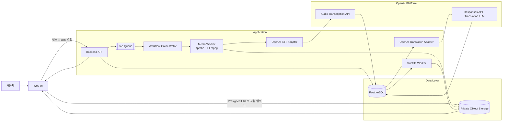
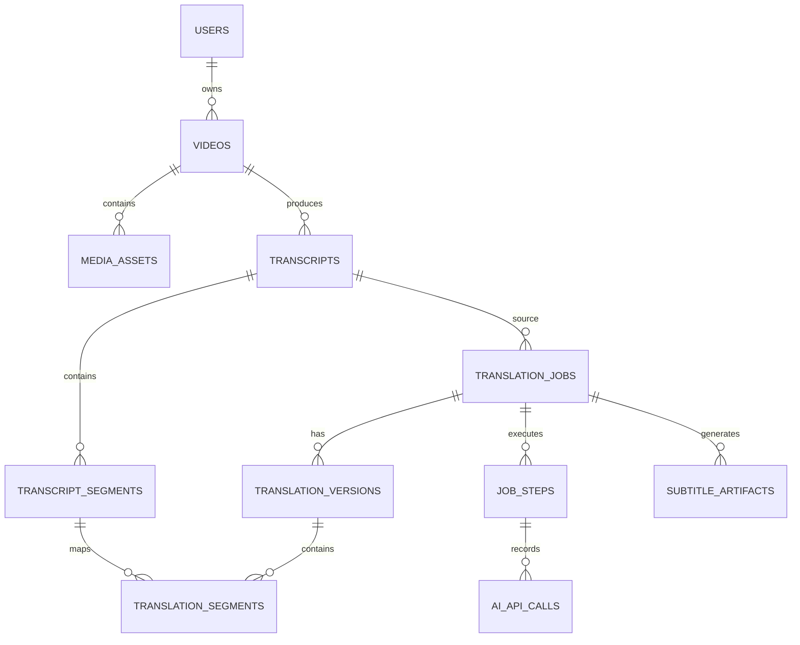

# 외국어 영상 번역 자막 시스템 설계안

버전: v0.1
상태: 목표 설계 및 MVP 구현 진행 중

세부 항목별 문서는 [`documents/README.md`](./documents/README.md)에서 확인한다.
현재 코드 구현 범위와 남은 작업은 [`documents/12-implementation-plan.md`](./documents/12-implementation-plan.md)에 기록한다.
포트폴리오용 아키텍처 표준 문서는 [`arc42`](./documents/arc42/README.md), [`C4`](./documents/c4/README.md),
[`ADR`](./documents/adr/README.md)로 나누어 관리한다.

## 1. 목표

사용자가 외국어 영상을 업로드하면 다음 결과를 제공한다.

- 영상의 음성을 텍스트로 변환한다.
- 원문 음성의 시간 정보가 유지된 자막 세그먼트를 만든다.
- 지정한 목표 언어로 번역한다.
- SRT 또는 VTT 자막 파일을 생성한다.
- 사용자가 번역문과 자막 타이밍을 수정할 수 있게 한다.

STT와 번역 LLM은 OpenAI API를 사용한다. 우리 시스템은 영상 처리, 작업 관리, 결과 저장, 편집 화면과 API를 담당한다.

## 2. MVP 범위

### 포함

- 영상 업로드
- 음성 언어 자동 감지
- 목표 언어 선택
- 영상에서 오디오 추출
- OpenAI STT를 통한 원문 생성
- OpenAI LLM을 통한 번역
- SRT/VTT 생성
- 작업 진행률 조회
- 세그먼트별 번역문 편집
- 실패 단계와 오류 상태 조회
- 결과 파일 다운로드

### MVP 이후

- 화자 분리 및 화자별 스타일
- 번역 영상 렌더링 또는 자막 번인
- 음성 더빙
- 실시간 자막
- 사용자 용어집과 번역 메모리
- 다중 목표 언어 일괄 생성

## 3. 전체 아키텍처



### 컴포넌트 책임

| 컴포넌트 | 책임 |
|---|---|
| Web UI | 업로드, 진행률, 자막 편집, 다운로드 |
| Backend API | 작업 생성, 상태 조회, 편집 저장과 export 요청 (현재는 개발용 단일 사용자) |
| Object Storage | 원본 영상, 정규화 오디오, 자막 파일 저장 |
| PostgreSQL | 작업 상태, 세그먼트, 버전, OpenAI 호출 정보 저장 |
| Job Queue | 장시간 작업의 비동기 실행 |
| Workflow Orchestrator | Worker 단계 순서와 상태 관리 |
| Media Worker | 파일 검증, 오디오 추출과 정규화 |
| OpenAI Adapters | OpenAI 호출, 응답 검증, 재시도, 사용량 기록 |
| Subtitle Worker | SRT/VTT 생성, 타이밍 및 줄바꿈 검증 |

API 서버와 Worker는 분리 배포할 수 있지만, 초기에는 하나의 코드베이스에서 프로세스만 분리한다.

## 4. 처리 파이프라인

```text
업로드
  ↓
파일 검증 및 미디어 분석
  ↓
오디오 추출·정규화·분할
  ↓
OpenAI STT
  ↓
원문 세그먼트 정리
  ↓
OpenAI 번역 LLM
  ↓
번역 결과 검증
  ↓
SRT/VTT 생성
  ↓
품질 검사
  ↓
결과 저장 및 다운로드
```

### 4.1 업로드

1. Backend가 업로드 세션과 `video_id`를 만든다.
2. 클라이언트는 Presigned URL로 Object Storage에 직접 업로드한다.
3. 업로드 완료 API가 파일 존재 여부, 크기, MIME 타입을 검증한다.
4. Worker가 `ffprobe`로 길이, 오디오 트랙, 코덱을 확인한다.

### 4.2 오디오 처리

- 영상에서 오디오 트랙을 추출한다.
- STT에 적합한 표준 포맷으로 정규화한다.
- 긴 오디오는 설정된 기준에 따라 여러 chunk로 나눈다.
- 각 chunk에는 `chunk_index`와 `offset_ms`를 부여한다.
- STT 결과의 상대 시간을 `offset_ms`로 보정해 전체 영상 시간축으로 변환한다.
- chunk 경계에서 중복 문장이 생기면 후처리 단계에서 제거한다.

영상 자체를 OpenAI STT에 전달하는 것이 아니라, 우리 시스템이 먼저 오디오를 추출한다.

### 4.3 원문 세그먼트

STT 결과를 자막에 적합한 단위로 정리한다.

- 문장부호와 음성의 pause를 기준으로 문장을 나눈다.
- 세그먼트마다 안정적인 `sequence_no`와 `segment_id`를 부여한다.
- 원문 텍스트와 시작·종료 시간을 함께 저장한다.
- 원문 세그먼트는 번역 언어가 달라도 재사용한다.

### 4.4 번역

번역 LLM에는 자막 세그먼트를 문맥 묶음으로 전달한다.

```json
{
  "source_language": "en",
  "target_language": "ko",
  "segments": [
    {
      "segment_id": "seg_001",
      "source_text": "Where are you going?"
    }
  ]
}
```

LLM 응답은 구조화된 JSON으로 제한한다.

```json
{
  "translations": [
    {
      "segment_id": "seg_001",
      "translated_text": "어디 가고 있어?"
    }
  ]
}
```

LLM은 시간 정보를 생성하지 않는다. 시간 정보는 원문 세그먼트에서 가져온다.

응답 검증 규칙:

- 요청한 `segment_id`가 모두 존재해야 한다.
- 알 수 없는 `segment_id`는 거부한다.
- 번역문이 비어 있으면 해당 chunk를 실패 처리한다.
- 원문 순서와 번역 결과 순서를 비교한다.
- JSON Schema 검증에 실패하면 재시도하지 않고 별도 오류로 기록한다.

### 4.5 자막 생성

- 기본 시간은 원문 세그먼트의 `start_ms`, `end_ms`를 사용한다.
- 사용자가 수정한 `display_start_ms`, `display_end_ms`가 있으면 이를 우선한다.
- 목표 줄 수와 한 줄 최대 글자 수를 설정값으로 관리한다.
- 빈 자막, 음수 시간, 겹치는 시간, 비정상적으로 긴 자막을 검사한다.
- 기본 출력은 SRT와 VTT로 한다.

## 5. 데이터 모델



### `users`

```text
id
email
created_at
```

인증을 나중에 붙일 경우에도 `user_id`를 미리 두는 편이 좋다.

### `videos`

```text
id
user_id
original_filename
storage_key
mime_type
file_size_bytes
status                 -- pending_upload, ready, processing, completed, deleted
created_at
deleted_at
```

### `media_assets`

```text
id
video_id
asset_type             -- original_video, normalized_audio, audio_chunk, thumbnail
storage_key
file_size_bytes
checksum
metadata_json
created_at
```

### `transcripts`

```text
id
video_id
source_language
provider                 -- openai
model
status
created_at
completed_at
```

한 영상에 STT를 다시 실행하면 새 Transcript 버전을 만든다.

### `transcript_segments`

```text
id
transcript_id
sequence_no
start_ms
end_ms
source_text
words_json
metadata_json
created_at
```

제약 조건:

- `(transcript_id, sequence_no)` unique
- `start_ms >= 0`
- `end_ms > start_ms`

### `translation_jobs`

```text
id
transcript_id
target_language
translation_style
status
current_step
progress
active_version_id
error_code
created_at
completed_at
cancelled_at
```

하나의 원문 Transcript에서 목표 언어별로 Translation Job을 만든다.

### `translation_versions`

```text
id
translation_job_id
version_no
provider
model
prompt_version
created_by               -- ai, user
is_current
created_at
```

재번역 또는 대규모 수정 시 새 버전을 만든다. 기존 버전은 삭제하지 않는다.

### `translation_segments`

```text
id
translation_version_id
transcript_segment_id
sequence_no
translated_text
display_start_ms
display_end_ms
review_status            -- pending, reviewed, edited
created_at
updated_at
```

### `job_steps`

```text
id
translation_job_id
step_type                -- validate, extract_audio, transcribe, translate, build_subtitle
status                   -- queued, running, completed, failed
attempt_count
idempotency_key
started_at
completed_at
error_code
error_message
```

### `ai_api_calls`

```text
id
job_step_id
operation                -- transcription, translation
provider                 -- openai
model
request_id
response_id
input_usage
output_usage
latency_ms
status
error_json
created_at
```

원본 음성, 전체 prompt, 전체 raw response는 기본적으로 장기 보관하지 않는다. 장애 분석이 필요한 경우에도 별도 보존 정책과 암호화를 적용한다.

### `subtitle_artifacts`

```text
id
translation_job_id
translation_version_id
format                   -- srt, vtt, ass, mp4
storage_key
file_size_bytes
checksum
created_at
```

## 6. 외부 API

기본 경로:

```text
/api/v1
```

| Method | Endpoint | 설명 |
|---|---|---|
| POST | `/videos/uploads` | 업로드 세션 생성 |
| POST | `/videos/{video_id}/complete` | 업로드 완료 통지 |
| GET | `/videos/{video_id}` | 영상 정보 조회 |
| POST | `/translation-jobs` | 번역 작업 생성 |
| GET | `/translation-jobs/{job_id}` | 작업 상태 조회 |
| POST | `/translation-jobs/{job_id}/cancel` | 작업 취소 |
| GET | `/translation-jobs/{job_id}/segments` | 자막 세그먼트 조회 |
| PATCH | `/translation-jobs/{job_id}/segments/{segment_id}` | 번역문·표시 시간 수정 |
| POST | `/translation-jobs/{job_id}/retranslate` | 새 번역 버전 생성 |
| POST | `/translation-jobs/{job_id}/exports` | 자막 파일 생성 |
| GET | `/artifacts/{artifact_id}` | 결과 파일 정보·다운로드 URL 조회 |

### 번역 작업 생성 요청

```json
{
  "video_id": "vid_123",
  "source_language": "auto",
  "target_language": "ko",
  "subtitle_format": "srt",
  "translation_style": "natural",
  "max_lines": 2,
  "max_chars_per_line": 42
}
```

### 상태 응답

```json
{
  "job_id": "job_456",
  "status": "TRANSLATING",
  "current_step": "TRANSLATING",
  "progress": 63,
  "source_language": "en",
  "target_language": "ko",
  "segment_count": 248,
  "translated_segment_count": 156,
  "artifacts": []
}
```

### API 규칙

- 장시간 작업 생성은 `202 Accepted` 성격으로 응답한다.
- 작업 생성, 재번역, export 요청에 `Idempotency-Key`를 지원한다.
- 모든 리소스에 소유권 검사를 적용한다.
- Object Storage key는 외부에 노출하지 않고 만료되는 signed URL만 반환한다.
- 초기에는 Polling을 사용하고, 이후 필요하면 SSE로 확장한다.
- `PATCH`에는 `version` 또는 `If-Match`를 사용해 동시 수정 충돌을 방지한다.

## 7. Queue와 Worker

### Queue 작업 종류

```text
video.validate
media.extract_audio
stt.transcribe
transcript.normalize
translation.translate
subtitle.build
job.finalize
```

### Queue 메시지 예시

```json
{
  "job_id": "job_456",
  "step": "translation.translate",
  "transcript_id": "tr_001",
  "translation_version_id": "tv_002",
  "batch_index": 4,
  "attempt": 1
}
```

### 재시도 정책

> 아래 정책은 운영 확장안이다. 현재 포트폴리오 MVP는 자동 재시도를 구현하지 않고, 실패 단계와
> 오류를 기록하는 데 집중한다.

- Timeout, 429, 일시적인 5xx: exponential backoff와 jitter로 재시도
- 잘못된 파일, 잘못된 요청, Schema 오류: 자동 재시도하지 않음
- 단계별 최대 시도 횟수를 둠
- 실패 메시지는 Dead Letter Queue 또는 실패 테이블에 보관
- 중복 메시지가 와도 `idempotency_key`로 결과 중복 생성을 막음

### 작업 상태

```text
QUEUED
  ↓
VALIDATING
  ↓
EXTRACTING_AUDIO
  ↓
TRANSCRIBING
  ↓
NORMALIZING
  ↓
TRANSLATING
  ↓
BUILDING_SUBTITLE
  ↓
COMPLETED
```

어느 단계에서 실패했는지 `job_steps`에 저장하므로 실패한 단계부터 재시작한다.

## 8. OpenAI 연동 계층

OpenAI API 호출은 Controller나 Web UI에서 직접 하지 않는다.

```text
OpenAIClient
 ├─ OpenAISttAdapter
 │   └─ transcribe(audio_asset, options)
 └─ OpenAITranslationAdapter
     └─ translate(segment_batch, options)
```

Adapter가 담당하는 기능:

- API 키와 클라이언트 초기화
- timeout, retry, rate limit 처리
- request ID와 response ID 기록
- 사용량과 지연 시간 기록
- 응답 JSON Schema 검증
- provider 오류를 내부 오류 코드로 변환
- 모델명과 prompt 버전 관리

모델명은 코드에 하드코딩하지 않고 환경 설정 또는 DB의 작업 설정으로 관리한다.

## 9. 보안과 개인정보

- OpenAI API 키는 서버 Secret Manager 또는 서버 환경변수에만 보관한다.
- 브라우저에는 API 키를 절대 전달하지 않는다.
- Object Storage는 private bucket으로 운영한다.
- 다운로드와 업로드 URL은 짧은 만료 시간을 가진다.
- 사용자별 영상·작업·자막 소유권을 검사한다.
- 업로드 파일의 확장자뿐 아니라 MIME 타입과 실제 미디어 정보를 검증한다.
- 파일명은 저장 경로로 직접 사용하지 않고 서버가 생성한 key를 사용한다.
- 원본 영상과 오디오는 보관 기간 정책에 따라 자동 삭제한다.
- API 사용량과 영상 길이에 사용자별 quota와 비용 제한을 둔다.
- 민감한 영상의 외부 API 전송 여부와 보존 정책을 서비스 약관에서 명확히 한다.

## 10. 관측성과 운영

모든 로그에 다음 correlation 정보를 포함한다.

```text
request_id
video_id
job_id
job_step_id
ai_api_request_id
```

수집할 주요 지표:

- 업로드 성공·실패율
- 단계별 처리 시간
- OpenAI 호출 성공·실패율
- 429 및 timeout 횟수
- STT 처리 오디오 분량
- 번역 입력·출력 사용량
- 작업당 예상 비용
- 재시도 횟수
- 자막 품질 검사 실패율
- 사용자 편집 비율

운영 알림 대상:

- Queue 적체 증가
- 특정 단계의 연속 실패
- OpenAI 오류율 급증
- Storage 용량 부족
- DB 연결 또는 migration 실패

## 11. 배포 구성

```text
Frontend
Backend API  ───── PostgreSQL
     │             Redis / Queue
     │             Object Storage
     └──── Worker ─ OpenAI API
```

초기 배포 단위:

- API와 정적 Web UI 서비스 1개
- Worker 서비스 1개
- PostgreSQL
- Redis 또는 Queue 서비스
- S3 호환 Object Storage

처리량이 늘어나면 다음처럼 확장한다.

- API는 stateless 수평 확장
- Media Worker와 OpenAI Worker를 별도 확장
- STT와 번역 Queue에 별도 동시성 제한
- 사용자별 quota와 전체 provider rate limit 적용

## 12. 테스트 전략

### Unit Test

- chunk offset 보정
- 세그먼트 정렬
- 시간 겹침 검사
- SRT/VTT 포맷 생성
- 줄바꿈 규칙
- JSON Schema 응답 검증
- retry와 idempotency 로직

### Integration Test

- Object Storage 업로드와 signed URL
- PostgreSQL migration
- Queue 등록과 Worker 실행
- OpenAI API mock 응답 처리
- 실패·재시도·중복 메시지 처리

### End-to-End Test

짧은 다국어 테스트 영상을 사용해 다음을 검증한다.

```text
업로드 → 작업 생성 → STT → 번역 → 자막 생성 → 다운로드 → 편집 → 재생성
```

### 품질 평가

- STT: 원문이 있는 테스트 세트의 WER/CER
- 번역: 언어별 샘플에 대한 사람 평가
- 자막: 타이밍 누락, 줄 길이, 겹침, 빈 세그먼트 검사
- 비용: 영상 길이별 API 사용량과 작업당 비용 기록

## 13. 구현 순서

### Phase 1: 실행 가능한 기본 파이프라인

- 프로젝트 초기화
- PostgreSQL migration
- Object Storage 업로드
- 영상 검증과 FFmpeg 오디오 추출
- Queue와 Worker
- OpenAI STT 연동
- OpenAI 번역 연동
- SRT 생성

### Phase 2: 제품 기능

- 작업 상태 UI
- VTT 지원
- 세그먼트 편집 화면
- 번역 버전 관리
- 재번역과 실패 단계 재시도
- 결과 다운로드

### Phase 3: 운영 안정화

- 인증과 사용자별 권한
- 사용량·비용 제한
- 관측성 대시보드
- 자동 삭제 정책
- 보안 점검
- 대용량·장시간 영상 최적화

## 14. 완료 기준

다음 조건을 만족하면 MVP 설계를 구현 가능한 상태로 본다.

- 사용자가 영상을 업로드할 수 있다.
- 영상이 API 요청을 차단하지 않고 비동기로 처리된다.
- STT와 번역 실패 시 실패 단계와 오류 정보를 확인할 수 있다. 자동 재시작은 운영 확장 항목이다.
- 하나의 Transcript를 여러 목표 언어 번역에 재사용할 수 있다.
- 세그먼트의 번역문을 수정하고 자막 파일만 다시 생성할 수 있다.
- SRT/VTT 파일을 다운로드할 수 있다.
- 브라우저에 OpenAI API 키가 노출되지 않는다.
- 모든 작업과 OpenAI 호출을 `job_id`로 추적할 수 있다.
- 중복 Queue 메시지가 결과를 중복 생성하지 않는다.

## 15. 검토가 필요한 결정 사항

다음 항목은 구현 시작 전에 확정한다.

1. 인증을 MVP부터 넣을지 여부
2. 허용할 최대 영상 크기와 길이
3. 기본 목표 언어와 지원 언어 목록
4. 원본 영상·오디오·자막의 보관 기간
5. SRT/VTT 외에 ASS를 MVP에 포함할지 여부
6. 번역 결과를 자연스럽게 할지 직역에 가깝게 할지
7. 번역 영상 렌더링을 언제 추가할지
8. OpenAI 모델을 환경변수로만 관리할지 관리자 설정으로 노출할지
9. 사용자 용어집을 MVP부터 지원할지 여부
