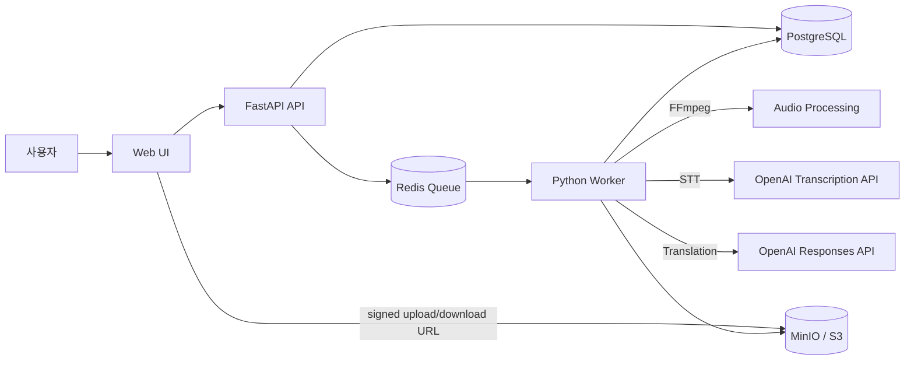

# Video Translator

외국어 영상의 음성을 인식하고 번역해, 시간 정보가 유지된 편집 가능한 SRT/VTT 자막을 만드는
포트폴리오용 MVP입니다.

영상 업로드부터 자막 다운로드까지의 전체 비동기 미디어 처리 흐름을 구현했습니다.

`Python 3.12` · `FastAPI` · `PostgreSQL` · `Redis` · `MinIO` · `OpenAI`

## Demo Flow

```text
영상 업로드
  → OpenAI STT
  → 번역 LLM
  → 자막 세그먼트 편집
  → SRT/VTT 다운로드
```

로컬 실행 후 브라우저에서 `http://127.0.0.1:8000`을 엽니다.

## 해결하려는 문제

영상 번역은 단순히 문장을 번역하는 작업이 아닙니다.

- 영상 처리는 오래 걸리므로 HTTP 요청을 계속 점유하면 안 됩니다.
- 번역 후에도 원문의 자막 타이밍이 유지되어야 합니다.
- 대용량 영상은 API 서버가 직접 중계하지 않는 편이 효율적입니다.
- 외부 AI 응답은 항상 예상한 구조와 형식인지 검증해야 합니다.

이 프로젝트는 위 문제를 Queue, Worker, timed transcript, signed URL, provider Adapter로
분리해 해결합니다.

## 핵심 기능

- signed URL을 통한 Object Storage 직접 업로드
- Redis Queue 기반 비동기 영상 처리
- FFmpeg 오디오 추출 및 정규화
- OpenAI `whisper-1` timed STT
- OpenAI Responses API 기반 구조화 번역
- 작업 단계별 상태와 진행률 조회
- 번역문과 자막 표시 시간 편집
- 번역 버전 관리와 SRT/VTT export
- 만료되는 signed download URL 제공

## 기술적으로 보여주는 것

| 문제 | 해결 방식 | 확인 위치 |
|---|---|---|
| 긴 작업으로 인한 HTTP timeout | API와 Worker 분리, Redis Queue 사용 | `worker/pipeline.py` |
| 번역 후 타이밍 유실 | STT timed segment의 시간 정보 재사용 | `backend/app/providers/openai_adapters.py` |
| 대용량 파일 중계 부담 | Private Storage와 signed URL 사용 | `backend/app/storage/s3.py` |
| 외부 AI 응답 불확실성 | Adapter에서 오류 변환과 JSON 구조 검증 | `backend/app/providers/openai_adapters.py` |
| 수정 결과의 재생성 | Translation Version과 Subtitle Artifact 분리 | `backend/app/db/models.py` |

## 아키텍처



처리 순서는 다음과 같습니다.

```text
업로드 세션 생성
  → Storage 직접 업로드
  → 업로드 완료 검증
  → 번역 Job 생성
  → Redis Queue 등록
  → Worker의 단계별 처리
  → 세그먼트 편집
  → 자막 Artifact 생성
```

## 주요 설계 결정

- [OpenAI Adapter로 STT와 번역 격리](documents/adr/ADR-001-openai-for-stt-and-translation.md)
- [Redis Queue와 별도 Worker로 비동기 처리](documents/adr/ADR-002-redis-queue-and-worker.md)
- [Private Object Storage와 signed URL 사용](documents/adr/ADR-003-signed-url-object-storage.md)
- [Timed segment 확보를 위한 `whisper-1` 선택](documents/adr/ADR-004-whisper-1-for-timed-segments.md)

## 실행 방법

### 사전 요구사항

- Python 3.12+
- Docker Desktop
- FFmpeg와 FFprobe
- OpenAI API Key

### 1. 프로젝트와 Python 환경 준비

```powershell
git clone https://github.com/MaoEmong/video-translator.git
cd video-translator
py -3.12 -m venv .venv
.\.venv\Scripts\Activate.ps1
python -m pip install -e ".[dev]"
```

### 2. 환경변수 설정

```powershell
Copy-Item .env.example .env
```

`.env`에 API Key와 모델을 입력합니다.

```env
OPENAI_API_KEY=여기에_API_키_입력
OPENAI_STT_MODEL=whisper-1
OPENAI_TRANSLATION_MODEL=gpt-5.6-terra
```

`.env`는 Git에 커밋하지 않습니다.

### 3. 인프라 실행과 migration

```powershell
docker compose up -d
.\.venv\Scripts\python.exe -m alembic upgrade head
```

Docker Compose가 PostgreSQL, Redis, MinIO와 MinIO bucket 초기화 컨테이너를 실행합니다.

### 4. API와 Worker 실행

터미널 1:

```powershell
.\.venv\Scripts\python.exe -m uvicorn app.main:app --app-dir backend --reload
```

터미널 2:

```powershell
.\.venv\Scripts\python.exe -m worker.main
```

브라우저에서 [http://127.0.0.1:8000](http://127.0.0.1:8000)을 엽니다.

## API 흐름

| 단계 | Endpoint | 설명 |
|---|---|---|
| 1 | `POST /api/v1/videos/uploads` | 업로드 세션 생성 |
| 2 | `POST /api/v1/videos/{video_id}/complete` | 업로드 완료 및 파일 검증 |
| 3 | `POST /api/v1/translation-jobs` | 비동기 번역 Job 생성 |
| 4 | `GET /api/v1/translation-jobs/{job_id}` | 진행률과 상태 polling |
| 5 | `PATCH /api/v1/translation-jobs/{job_id}/segments/{segment_id}` | 번역문·표시 시간 편집 |
| 6 | `POST /api/v1/translation-jobs/{job_id}/exports` | SRT/VTT 생성 |
| 7 | `GET /api/v1/artifacts/{artifact_id}` | signed download URL 조회 |

Swagger 문서는 실행 후 [http://127.0.0.1:8000/docs](http://127.0.0.1:8000/docs)에서 확인할 수 있습니다.

## 검증

```powershell
.\.venv\Scripts\python.exe -m pytest -q
.\.venv\Scripts\ruff.exe check backend worker
node --check frontend/app.js
docker compose config --quiet
```

현재 자동 테스트 19개가 통과하며, 업로드·작업 생성 API와 번역→자막 생성 파이프라인을 외부 서비스
mock으로 검증합니다. Docker·MinIO·FFmpeg·OpenAI를 연결한 실제 smoke test도 완료했습니다.

## 포트폴리오 범위

이 프로젝트는 상용 서비스 전체가 아니라 비동기 미디어 처리 아키텍처를 보여주는 데모입니다.
현재는 짧은 영상과 단일 로컬 실행 환경을 기준으로 합니다.

의도적으로 제외한 기능:

- 사용자 인증과 multi-tenant 권한
- 장시간 영상 chunk 분할과 화자 분리
- 자동 재시도 정책과 Idempotency-Key
- 번역 영상 렌더링과 음성 더빙
- 운영 모니터링, quota, 결제, 자동 보관 삭제

운영 확장 backlog는 [운영 확장 검토 사항](documents/13-open-decisions.md)에 기록했습니다.

## 프로젝트 구조

```text
backend/app/
  api/          REST API와 요청 처리
  db/           SQLAlchemy 모델과 세션
  providers/    OpenAI Adapter
  queue/        Redis Queue client
  storage/      MinIO/S3 gateway
  subtitles/    SRT/VTT builder
worker/         비동기 처리 pipeline
frontend/       Vanilla HTML/CSS/JavaScript UI
documents/      arc42, C4, ADR 및 상세 설계
```

## 문서

- [arc42 아키텍처 문서](documents/arc42/README.md)
- [C4 모델](documents/c4/README.md)
- [Architecture Decision Records](documents/adr/README.md)
- [주제별 상세 설계](documents/README.md)
- [통합 설계 문서](DESIGN.md)
