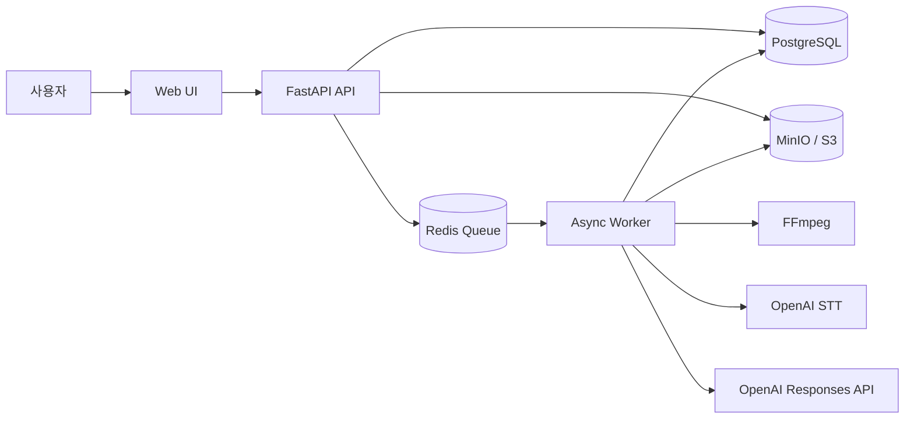

# Video Translator

외국어 영상의 음성을 인식하고 OpenAI로 번역한 뒤, 시간 정보가 유지된 SRT/VTT 자막을
생성하는 포트폴리오용 MVP입니다.

## 한눈에 보는 데모

```text
영상 선택
  → Object Storage 직접 업로드
  → Redis Queue 작업 등록
  → Worker가 FFmpeg로 오디오 추출
  → OpenAI STT
  → OpenAI 번역 LLM
  → 자막 생성
  → 번역문·타이밍 편집
  → SRT/VTT 다운로드
```

웹 UI는 API 서버가 함께 제공합니다.

```text
http://127.0.0.1:8000
```

## 아키텍처



## 기술 선택

| 영역 | 선택 | 역할 |
|---|---|---|
| API | FastAPI | 업로드 세션, 작업 상태, 세그먼트 편집, export |
| DB | PostgreSQL + SQLAlchemy | 영상·Transcript·번역 버전·작업 단계 저장 |
| Queue | Redis | 장시간 작업 비동기 처리 |
| Worker | Python asyncio | FFmpeg, STT, 번역, 자막 생성 실행 |
| STT | OpenAI `whisper-1` | 시간 세그먼트가 포함된 원문 생성 |
| 번역 | OpenAI `gpt-5.6-terra` | 구조화된 JSON 번역 결과 생성 |
| Storage | MinIO / S3 호환 API | 원본 영상과 결과 자막 저장 |
| UI | Vanilla HTML/CSS/JavaScript | 업로드, 진행률, 편집, 다운로드 |

## 실행 방법

### 1. Python 환경 준비

```powershell
py -3.12 -m venv .venv
.\.venv\Scripts\Activate.ps1
python -m pip install -e ".[dev]"
```

### 2. 환경변수 설정

이미 생성된 [`.env`](D:/video_project/.env)에 API 키를 입력합니다.

```env
OPENAI_API_KEY=여기에_API_키_입력
OPENAI_STT_MODEL=whisper-1
OPENAI_TRANSLATION_MODEL=gpt-5.6-terra
```

### 3. 인프라 실행과 DB migration

```powershell
docker compose up -d
.\.venv\Scripts\python.exe -m alembic upgrade head
```

Docker Compose는 PostgreSQL, Redis, MinIO와 MinIO bucket 초기화 컨테이너를 실행합니다.

### 4. API와 Worker 실행

터미널 1:

```powershell
.\.venv\Scripts\python.exe -m uvicorn app.main:app --app-dir backend --reload
```

터미널 2:

```powershell
.\.venv\Scripts\python.exe -m worker.main
```

브라우저에서 `http://127.0.0.1:8000`을 엽니다.

## API 흐름

1. `POST /api/v1/videos/uploads`로 signed upload URL을 받습니다.
2. 응답의 URL로 영상을 `PUT` 업로드합니다.
3. `POST /api/v1/videos/{video_id}/complete`로 업로드를 완료합니다.
4. `POST /api/v1/translation-jobs`로 번역 작업을 등록합니다.
5. `GET /api/v1/translation-jobs/{job_id}`로 진행률을 polling합니다.
6. 완료 후 세그먼트를 수정하거나 `POST /api/v1/translation-jobs/{job_id}/exports`로 자막을 생성합니다.
7. `GET /api/v1/artifacts/{artifact_id}`에서 signed download URL을 받습니다.

Swagger 문서:

```text
http://127.0.0.1:8000/docs
```

## 검증

```powershell
.\.venv\Scripts\python.exe -m pytest -q
.\.venv\Scripts\ruff.exe check backend worker
node --check frontend/app.js
```

현재 자동 테스트는 19개이며, 업로드·작업 생성 API와 번역→자막 생성 파이프라인을 외부 서비스
mock으로 검증합니다. 별도로 Docker·MinIO·FFmpeg·OpenAI를 연결한 실제 smoke test도 완료했습니다.

## 포트폴리오 범위

이 프로젝트는 운영 서비스가 아니라 비동기 미디어 처리 아키텍처를 보여주는 데모입니다.
따라서 다음 기능은 의도적으로 제외했습니다.

- 사용자 인증과 multi-tenant 권한
- 장시간 영상 chunk 분할과 화자 분리
- 재시도 정책과 Idempotency-Key
- 번역 영상 렌더링과 음성 더빙
- 운영 모니터링, quota, 결제, 자동 보관 삭제

아키텍처 표준 문서는 [arc42](D:/video_project/documents/arc42/README.md),
[C4](D:/video_project/documents/c4/README.md), [ADR](D:/video_project/documents/adr/README.md)에서
확인할 수 있습니다. 주제별 상세 설계와 구현 상태는 [documents/README.md](D:/video_project/documents/README.md)와
[DESIGN.md](D:/video_project/DESIGN.md)에서 확인할 수 있습니다.
