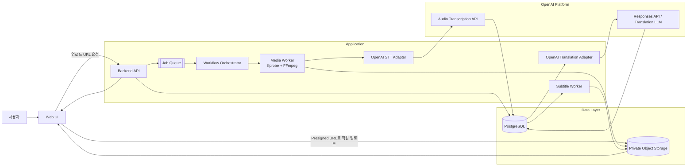

# 01. 시스템 아키텍처

## 구성도



## 컴포넌트 책임

| 컴포넌트 | 책임 |
|---|---|
| Web UI | 업로드, 진행률, 자막 편집, 다운로드 |
| Backend API | 인증, 권한, 작업 생성, 상태 조회, 편집 저장 |
| Object Storage | 원본 영상, 파생 오디오, 결과 자막 저장 |
| PostgreSQL | 작업 상태, 세그먼트, 버전, 사용량 저장 |
| Job Queue | 장시간 작업의 비동기 실행 |
| Orchestrator | 단계 순서, 체크포인트, 재시도 관리 |
| Media Worker | 파일 검증, 미디어 분석, 오디오 추출·분할 |
| OpenAI Adapter | API 호출, 응답 검증, 오류 변환, 사용량 기록 |
| Subtitle Worker | SRT/VTT 생성과 품질 검사 |

## 서비스 경계

초기에는 하나의 코드베이스에서 관리한다.

```text
frontend/
backend/
worker/
shared/
```

배포 시에는 API, Worker, Scheduler 프로세스로 분리할 수 있다.

## 핵심 경계

- 프론트엔드는 OpenAI API를 호출하지 않는다.
- API 서버는 영상 바이너리를 직접 중계하지 않고 signed URL을 발급한다.
- Worker만 Queue에서 작업을 소비한다.
- DB에는 외부 저장소의 key를 저장하고 공개 URL은 저장하지 않는다.
