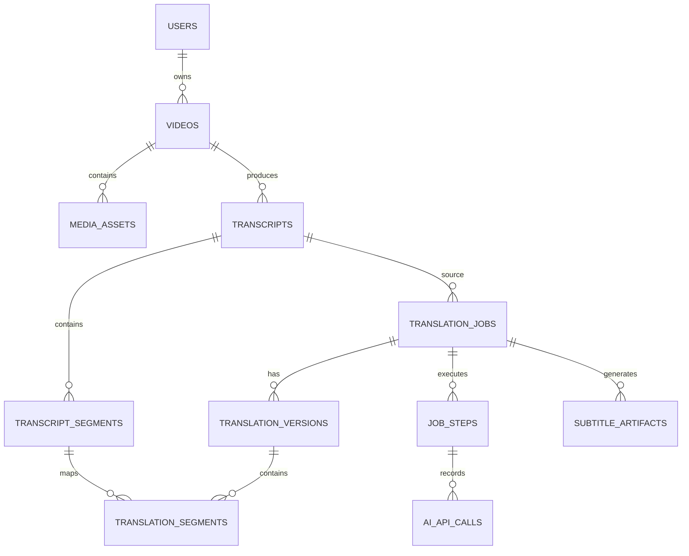

# 03. 데이터 모델

## ERD



## 핵심 테이블

### `users`

```text
id, email, created_at
```

### `videos`

```text
id
user_id
original_filename
storage_key
mime_type
file_size_bytes
status
created_at
deleted_at
```

### `media_assets`

```text
id
video_id
asset_type              -- original_video, normalized_audio, audio_chunk, thumbnail
storage_key
file_size_bytes
checksum
metadata_json
created_at
```

### `transcripts`

```text
id
video_id
source_language
provider
model
status
created_at
completed_at
```

### `transcript_segments`

```text
id
transcript_id
sequence_no
start_ms
end_ms
source_text
words_json
metadata_json
created_at
```

제약 조건:

- `(transcript_id, sequence_no)` unique
- `start_ms >= 0`
- `end_ms > start_ms`

### `translation_jobs`

```text
id
video_id
transcript_id
target_language
translation_style
status
current_step
progress
active_version_id
error_code
created_at
completed_at
cancelled_at
```

Translation Job은 먼저 영상을 참조해 생성하고, STT가 완료되면 `transcript_id`를 연결한다. 같은 영상의 다른 언어 작업은 완료된 Transcript를 재사용한다.

### `translation_versions`

```text
id
translation_job_id
version_no
provider
model
prompt_version
created_by               -- ai, user
is_current
created_at
```

### `translation_segments`

```text
id
translation_version_id
transcript_segment_id
sequence_no
translated_text
display_start_ms
display_end_ms
review_status            -- pending, reviewed, edited
created_at
updated_at
```

### `job_steps`

```text
id
translation_job_id
step_type                -- validate, extract_audio, transcribe, translate, build_subtitle
status                   -- queued, running, completed, failed
attempt_count
idempotency_key
started_at
completed_at
error_code
error_message
```

### `ai_api_calls`

```text
id
job_step_id
operation                -- transcription, translation
provider
model
request_id
response_id
input_usage
output_usage
latency_ms
status
error_json
created_at
```

### `subtitle_artifacts`

```text
id
translation_job_id
translation_version_id
format
storage_key
file_size_bytes
checksum
created_at
```

## 인덱스

```text
transcript_segments(transcript_id, sequence_no)
translation_segments(translation_version_id, sequence_no)
translation_jobs(status)
job_steps(translation_job_id, step_type)
videos(user_id, created_at)
```

모든 ID는 UUID 또는 ULID를 사용하고, 시간 값은 정수 밀리초를 사용한다.
