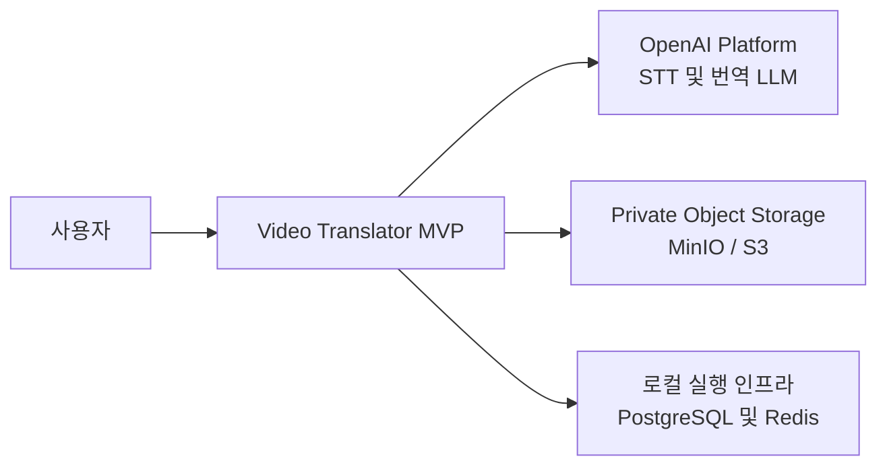

# 3. 시스템 범위와 컨텍스트

## 시스템 컨텍스트

## 범위 안

- 영상 업로드 세션과 Object Storage 직접 업로드
- 영상 검증 및 FFmpeg 오디오 정규화
- 시간 세그먼트가 포함된 OpenAI STT
- 구조화된 JSON 응답을 사용하는 번역 LLM
- 작업 상태와 단계별 진행률 저장
- 번역 세그먼트 편집
- SRT/VTT 자막 생성과 signed download URL

## 범위 밖

- 로그인, 사용자별 권한, multi-tenant 격리
- 장시간 영상 chunk 분할, 화자 분리, 실시간 처리
- 음성 더빙, 자막 번인, 번역 영상 렌더링
- 결제, quota, 자동 보관 삭제, 운영 대시보드

상세 API와 데이터 모델은 [주제별 상세 설계](../README.md)의 API·데이터 모델 문서를 참조한다.
