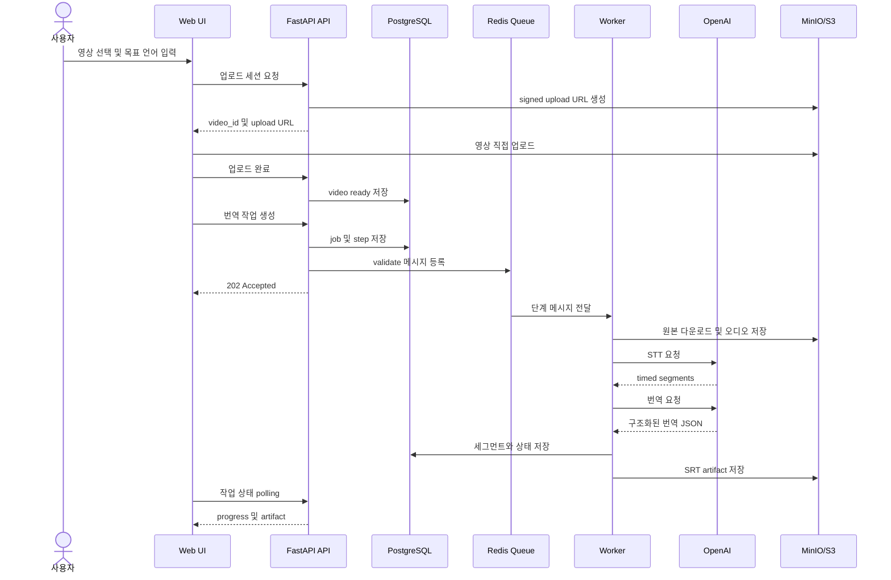

# 6. 런타임 뷰

## 번역 작업 흐름

## 편집과 export 흐름

1. UI가 `GET /translation-jobs/{job_id}/segments`로 번역 세그먼트를 조회한다.
2. 사용자가 번역문 또는 표시 시간을 수정한다.
3. API가 `PATCH`로 DB의 translation segment를 갱신한다.
4. 사용자가 export를 요청하면 기존 버전의 세그먼트로 SRT/VTT를 생성한다.
5. artifact는 Storage에 저장하고 API는 만료되는 signed download URL을 반환한다.

## 실패 흐름

Worker가 오류를 내부 오류 코드로 변환하고 현재 step과 job을 실패 상태로 기록한다. 이미 성공한
artifact를 다시 export하는 요청은 동일 artifact를 재사용해 중복 파일 생성을 피한다.
