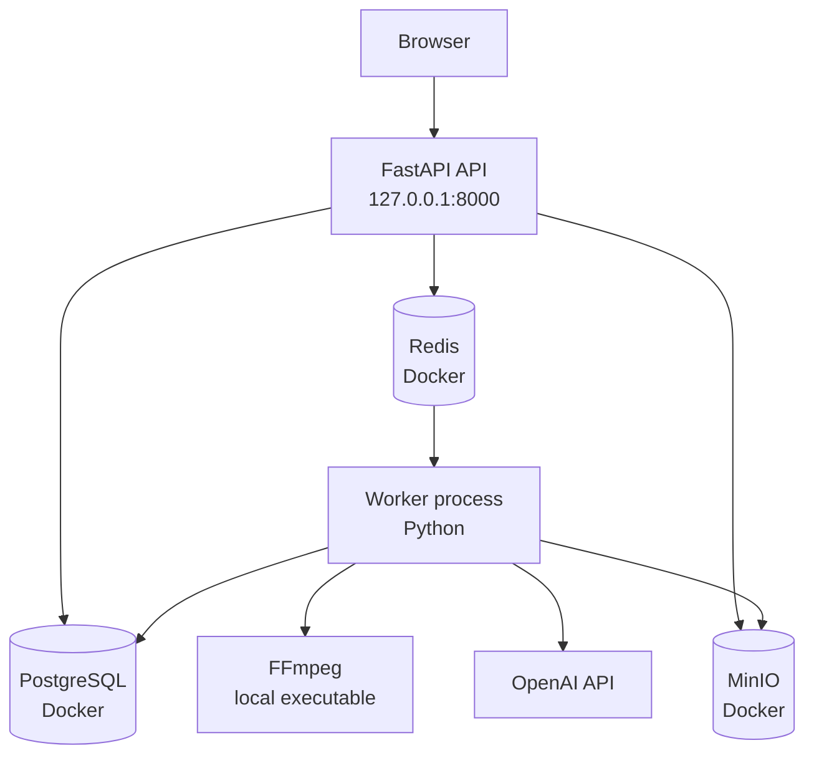

# 7. 배포 뷰

## 로컬 MVP 배포

## 실행 단위

- Docker Compose: PostgreSQL, Redis, MinIO, MinIO bucket initializer
- API 프로세스: FastAPI와 정적 Web UI
- Worker 프로세스: Redis에서 메시지를 읽어 파이프라인 수행
- 외부 서비스: OpenAI STT 및 Responses API

## 설정

비밀값은 `.env`에 두고 Git에 커밋하지 않는다. 주요 설정은 `OPENAI_API_KEY`,
`OPENAI_STT_MODEL`, `OPENAI_TRANSLATION_MODEL`, DB/Redis/Storage 연결 정보다.

재현 절차는 루트 [README](../../README.md)의 실행 방법을 따른다.
