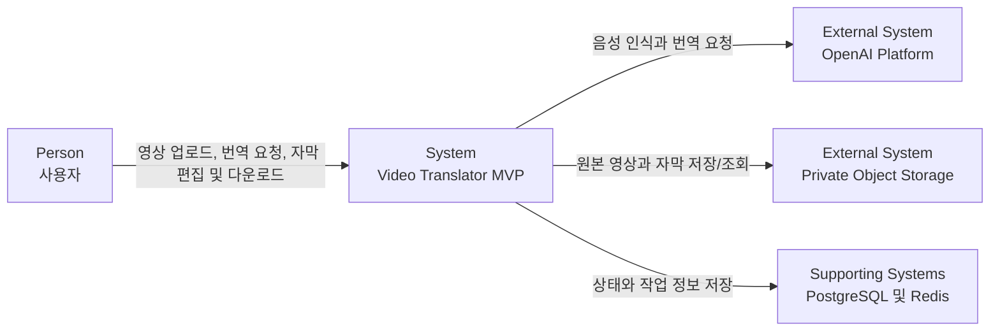

# C4 Level 1: System Context

## 다이어그램

## 관계

| 요소 | 설명 |
|---|---|
| 사용자 | 외국어 영상의 목표 언어를 선택하고 결과 자막을 검토한다. |
| Video Translator MVP | 업로드, 비동기 처리, AI 호출, 자막 편집과 export를 조정한다. |
| OpenAI Platform | timed STT와 구조화된 번역 결과를 제공한다. |
| Private Object Storage | 원본 영상, 정규화 오디오, 결과 자막을 보관한다. |
| PostgreSQL 및 Redis | 작업 상태와 도메인 데이터를 저장하고 비동기 메시지를 전달한다. |
