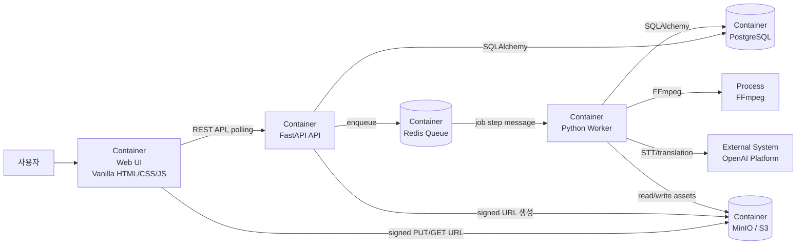

# C4 Level 2: Container

## 다이어그램

## 컨테이너 책임

| 컨테이너 | 책임 | 구현 위치 |
|---|---|---|
| Web UI | 파일 선택, 업로드, polling, 편집, 다운로드 | `frontend/` |
| FastAPI API | 리소스 생성/조회/수정, signed URL, Queue 등록 | `backend/app/api/` |
| Redis Queue | 작업 메시지의 producer/consumer 경계 | `backend/app/queue/` |
| Python Worker | 작업 단계 실행과 상태 전이 | `worker/` |
| PostgreSQL | Video, Transcript, Job, Version, Segment, Artifact 저장 | `backend/app/db/` |
| MinIO/S3 | 원본과 파생 파일의 binary storage | `backend/app/storage/` |
| FFmpeg | 영상에서 표준 WAV 오디오 추출 | Worker 프로세스에서 실행 |

API와 Worker는 같은 Python 코드베이스를 공유하지만 별도 프로세스로 실행한다. Docker Compose는
PostgreSQL, Redis, MinIO를 로컬 컨테이너로 제공한다.
