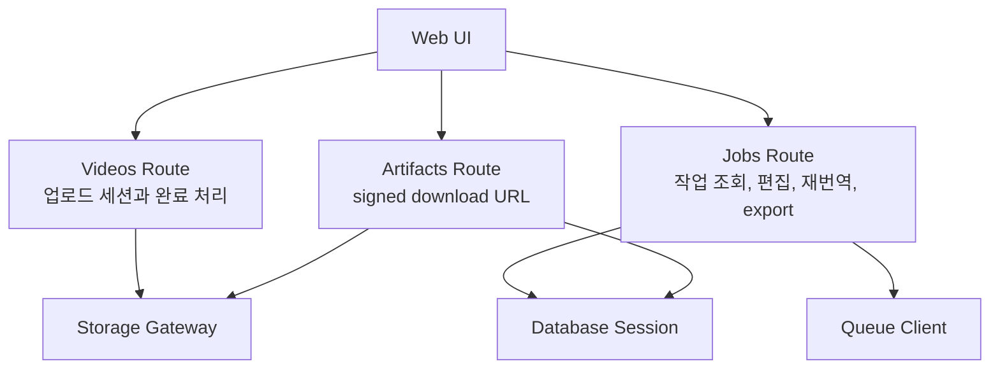
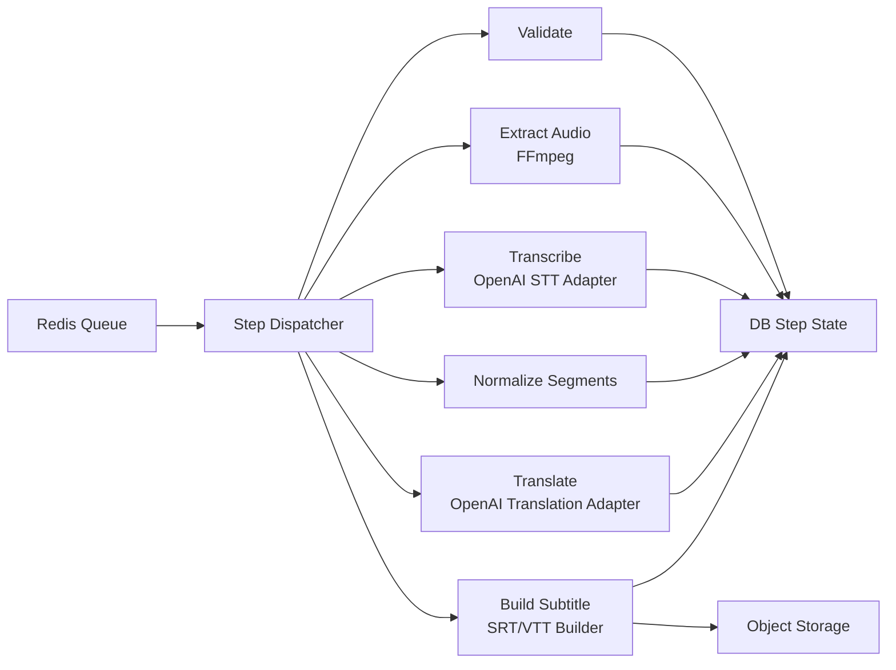

# C4 Level 3: Component

이 뷰는 코드 파일 전체를 나열하지 않고, 변경 이유가 다른 주요 책임 단위만 보여준다.

## API 컴포넌트

| 컴포넌트 | 책임 | 코드 위치 |
|---|---|---|
| Videos Route | 업로드 세션, 완료 검증, 영상 조회 | `backend/app/api/routes/videos.py` |
| Jobs Route | 작업 생성/조회, 세그먼트 편집, 재번역, export | `backend/app/api/routes/jobs.py` |
| Artifacts Route | artifact 메타데이터와 signed URL 제공 | `backend/app/api/routes/artifacts.py` |
| Storage Gateway | S3 호환 presigned URL, 객체 조회/저장 | `backend/app/storage/s3.py` |
| Queue Client | Redis 메시지 enqueue/dequeue | `backend/app/queue/client.py` |
| Database Session | 비동기 SQLAlchemy 세션과 트랜잭션 경계 | `backend/app/db/session.py` |

## Worker 컴포넌트

| 컴포넌트 | 책임 | 코드 위치 |
|---|---|---|
| Step Dispatcher | Queue 메시지에 맞는 단계 handler 선택 | `worker/pipeline.py` |
| Media Handler | 원본 검증과 WAV 오디오 정규화 | `worker/pipeline.py` |
| STT Adapter | timed segment 요청, provider 응답/오류 변환 | `backend/app/providers/openai_adapters.py` |
| Translation Adapter | JSON schema 기반 번역 결과 생성/검증 | `backend/app/providers/openai_adapters.py` |
| Segment Normalizer | 원문 세그먼트 순서와 식별자 정리 | `worker/pipeline.py` |
| Subtitle Builder | 번역 세그먼트를 SRT/VTT로 직렬화 | `backend/app/subtitles/builder.py` |
| Failure Handler | 단계 실패와 내부 오류 코드 저장 | `worker/pipeline.py` |
